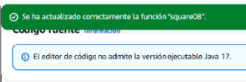
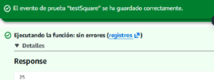
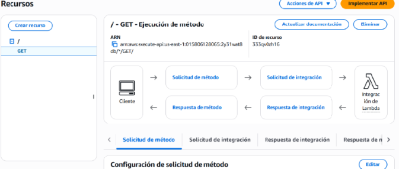
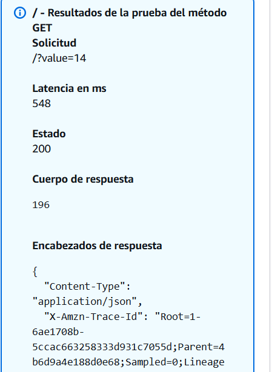
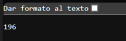

# Taller: Microservicio serverless con Java, AWS Lambda y API Gateway

> **Autor:** Juan Esteban Lozano

## ¿De qué trata este taller?

El objetivo es construir el "Hola mundo" de los microservicios serverless: un servicio que, dado un número entero, responde con ese número elevado al cuadrado. El código se escribe en Java, se ejecuta dentro de una función de **AWS Lambda** y queda accesible por HTTP gracias a **Amazon API Gateway**, sin tener que aprovisionar ni mantener ningún servidor.

**Ejemplo rápido:**

| Petición | Respuesta |
|----------|-----------|
| `GET /Beta?value=14` | `196` |

URL completa usada en las pruebas:
`https://2y31wat8db.execute-api.us-east-1.amazonaws.com/Beta?value=13`

---

## Tecnologías utilizadas

- **Java 17** — lenguaje del servicio (Lambda ya no acepta funciones nuevas con Java 8).
- **Maven 3** — compilación, pruebas y empaquetado.
- **JUnit** — pruebas unitarias.
- **AWS Lambda** — ejecución del código bajo demanda.
- **Amazon API Gateway** — exposición del servicio como API REST.
- **AWS Academy** — entorno del laboratorio (rol `LabRole`).

---

## Cómo viaja una petición

1. El usuario abre la URL en el navegador o la llama con `curl`, enviando el parámetro `value` en la query string.
2. **API Gateway** (API REST `mathServices`, endpoint regional) recibe la petición y aplica una *mapping template* (`$input.params("value")`) que extrae únicamente el número.
3. Ese número, sin envoltorio JSON, llega a la función **Lambda `square08`**.
4. Lambda invoca el handler `co.edu.escuelaing.services.MathServices::square`, que calcula el cuadrado.
5. El resultado (por ejemplo, `196`) vuelve al cliente a través de API Gateway.

Como la plantilla entrega un valor simple y no un objeto, el handler puede ser un método estático que recibe directamente un `Integer`.

---

## El código

Organización del repositorio:

| Ruta | Contenido |
|------|-----------|
| `src/main/java/co/edu/escuelaing/services/MathServices.java` | Handler con la lógica del servicio |
| `src/test/java/co/edu/escuelaing/services/MathServicesTest.java` | Pruebas unitarias |
| `pom.xml` | Configuración de Maven |

Toda la lógica cabe en un método:

```java
package co.edu.escuelaing.services;

/**
 * Servicio matemático expuesto como función AWS Lambda.
 */
public class MathServices {

    /**
     * Handler de la Lambda: recibe un número entero y devuelve su cuadrado.
     *
     * @param number valor recibido desde API Gateway
     * @return el número multiplicado por sí mismo
     */
    public static Integer square(Integer number) {
        int value = number;
        int result = value * value;
        return result;
    }
}
```

Fíjate en que no se importa ninguna librería de AWS: Lambda se encarga de convertir la entrada al tipo `Integer` por sí sola.

---

## Construir el proyecto localmente

Necesitas tener instalados **JDK 17** y **Maven 3**. Luego, desde la raíz del proyecto:

```bash
mvn package
```

Este comando corre las tres pruebas unitarias (número positivo, número negativo y cero) y, si pasan, produce el JAR que se sube a AWS:

```
target/math-services-1.0-SNAPSHOT.jar
```

Salida esperada de las pruebas:

```
Tests run: 3, Failures: 0, Errors: 0, Skipped: 0
```

---

## Puesta en marcha en AWS

### Paso 1 — Crear la función Lambda

Se creó la función con estos parámetros:

- **Nombre:** `square08`
- **Runtime:** Java 17
- **Rol de ejecución:** `LabRole` (AWS Academy)
- **Código subido:** `math-services-1.0-SNAPSHOT.jar`
- **Handler:** `co.edu.escuelaing.services.MathServices::square`

**Verificación:** se configuró un evento de prueba llamado `testSquare` cuyo cuerpo es solamente `5` (no un JSON). La función respondió `25`.

### Paso 2 — Exponerla con API Gateway

Se creó una API REST llamada `mathServices` con endpoint **Regional** y se configuró así:

- **Recurso y método:** `GET` sobre `/`, integrado con la Lambda `square08` en modo **no proxy**.
- **Method request:** parámetro de query string `value`, marcado como obligatorio.
- **Integration request:** `value` mapeado desde `method.request.querystring.value`.
- **Mapping template** para `application/json`:

  ```
  $input.params("value")
  ```

- **Stage de despliegue:** `Beta`.

Gracias a la plantilla, la función recibe el valor de `value` como un número suelto. 

**Verificación:**
- Desde la consola de API Gateway, la prueba del método con `value=14` devolvió código `200` y cuerpo `196`.
- Tras desplegar en el stage `Beta`, la misma consulta hecha desde el navegador también devolvió `196`.

### Paso 3 — Liberar recursos

Al terminar, se borraron la función `square08` y la API `mathServices` para evitar cobros innecesarios.

---

## Capturas de pantalla

**Función Lambda creada**



**Prueba de la Lambda: entrada `5`, salida `25`**



**Configuración del método GET en API Gateway**



**Prueba en API Gateway: `value=14`, salida `196`**



**Llamada al servicio desde el navegador**



---

## Lecciones aprendidas

1. **Serverless de verdad:** basta con subir el código y definir cómo llegan las peticiones; AWS se ocupa de la infraestructura.
2. **El mapping template manda:** es la pieza que decide qué datos le llegan a la función. Aquí se envió un solo número, pero en la práctica lo habitual es mandar JSON que Lambda transforma en POJOs.
3. **Tipos flexibles en el handler:** en Java se pueden usar como entrada y salida tipos primitivos o `String`, eventos ya definidos en `aws-lambda-java-events` (como `S3Event`) o clases propias; Lambda serializa y deserializa todo automáticamente.
aws-lambda-java-events` (por ejemplo `S3Event`) o POJOs propios, que Lambda serializa y deserializa automáticamente.
aws-lambda-java-events` (por ejemplo `S3Event`) o POJOs propios, que Lambda serializa y deserializa automáticamente.
aws-lambda-java-events` (por ejemplo `S3Event`) o POJOs propios, que Lambda serializa y deserializa automáticamente.
aws-lambda-java-events` (por ejemplo `S3Event`) o POJOs propios, que Lambda serializa y deserializa automáticamente.
aws-lambda-java-events` (por ejemplo `S3Event`) o POJOs propios, que Lambda serializa y deserializa automáticamente.
